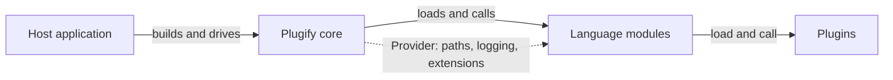

This page describes Plugify 3 (core 3.1). It explains what the core does, how it finds and loads extensions and how plugins in different languages call each other.

## Parts



| Part | What it does |
|---|---|
| **Host** | The application that embeds the core: a game server host such as S2-Launcher, your own program or the `plug` test application. It creates the core, calls `Update` every frame and shuts it down |
| **Core** | The `plugify` library. It finds manifests, checks them, resolves dependencies, loads extensions in order and drives their life cycle. It never talks to plugins directly |
| **Language module** | A native library that implements `ILanguageModule`. It loads plugins of one language, starts and stops them and makes the methods of all plugins callable in its language |
| **Plugin** | Code in some language with a `*.pplugin` manifest. The methods listed in the manifest can be called by any other plugin |

Language modules and plugins are both **extensions**: one class, `Extension`, describes both, and they share the same loading pipeline, states, dependencies and conflicts. The core loads a C++ plugin through the C++ language module like any other plugin.

## Host API

The host works with three objects:

- `PlugifyBuilder` sets up the core: folders, config, logger and the services it uses. `Plugify::CreateBuilder()` creates one, `Build()` returns the core.
- `Plugify` is the core object: `Initialize()` checks and creates the folders, `Update()` is called every frame, `Terminate()` unloads everything.
- `Manager`, returned by `GetManager()`, loads extensions with `Initialize()`, unloads them with `Terminate()` and lets you look them up: `FindExtension`, `GetExtensions`, `GetExtensionsByState`, `IsExtensionLoaded`.

Methods that can fail return `plugify::Result<T>`, which is `std::expected<T, std::string>`: the error is a message. `Initialize`, `Update` and `Terminate` must be called from the thread that created the core.

:read-more{icon="lucide:plug" to="/core/embedding/integrating" title="Integrating"}

### Configuration

`Build()` merges the settings from three sources. Each next source overrides the previous one:

1. the config file given with `WithConfigFile`;
2. the `Config` given with `WithConfig`;
3. `WithBaseDir` and `WithPaths`.

The core never looks for a config file by itself. If `baseDir` is empty, the current folder is used. The other folders are relative to `baseDir`. `Initialize()` fails if `baseDir` does not exist and creates the other folders if they are missing.

### Services

The core takes its building blocks from a service locator. `Build()` registers defaults for those you did not replace:

| Service | Builder method | Default |
|---|---|---|
| `ILogger` | `WithLogger` | Writes to the console |
| `IFileSystem` | `WithFileSystem` | Standard file system |
| `IAssemblyLoader` | `WithAssemblyLoader` | Loads native libraries with the platform loader |
| `IDependencyResolver` | `WithDependencyResolver` | libsolv |
| `IProfiler` | `WithProfiler` | None |
| `IExtensionLifecycle` | `WithExtensionLifecycle` | None. If set, it is told about every load, start, update, end and unload |

Language modules reach the same services through `Provider::Resolve<T>()`.

## Extensions and manifests

### Manifest files

Every extension has a manifest, a JSON file in the root of its folder. Comments are allowed. There are three kinds:

| File | Describes |
|---|---|
| `*.pplugin` | A plugin: its language, entry point, dependencies and exported methods |
| `*.pmodule` | A language module: the language it serves and its runtime library |
| `*.pconfig` | Settings of the core. Optional, read only when the host passes it to the core |

The optional `$schema` key enables autocompletion in editors. Keys that the schema does not know make the manifest invalid.

#### Plugin manifest

```json [my_plugin.pplugin]
{
  "$schema": "https://raw.githubusercontent.com/untrustedmodders/plugify/refs/heads/main/schemas/plugin.schema.json",
  "name": "my_plugin",
  "version": "1.0.0",
  "description": "An example plugin",
  "author": "Your Name",
  "website": "https://example.com",
  "license": "MIT",
  "language": "cpp",
  "entry": "bin/my_plugin",
  "platforms": [],
  "dependencies": [
    { "name": "s2sdk", "constraints": ">=3.0.0" },
    { "name": "configs", "optional": true }
  ],
  "methods": [
    {
      "name": "AddNumbers",
      "funcName": "AddNumbers",
      "paramTypes": [
        { "name": "a", "type": "int32" },
        { "name": "b", "type": "int32" }
      ],
      "retType": { "type": "int32" }
    }
  ]
}
```

| Field | Required | Meaning |
|---|---|---|
| `name` | yes | Unique name: letters, digits and `_`, starting with a letter or `_`. Use `snake_case`. Dependencies and imports refer to it |
| `version` | yes | Semantic version, `MAJOR.MINOR.PATCH` |
| `description`, `author`, `website`, `license` | yes | Information about the plugin. `website` is an `http(s)` URL |
| `language` | yes | The language of the plugin. It must match the `language` of an installed module: `cpp`, `dotnet`, `golang`, `python3`, `javascript`, `lua`, `rust` |
| `entry` | yes | The entry point. Its format depends on the language, see the First Plugin page of your language |
| `platforms` | no | Platforms the plugin supports. An empty list means all |
| `dependencies` | no | Plugins that must be loaded first: `name`, optional `constraints` and `optional` |
| `conflicts` | no | Plugins this one cannot be loaded with: `name`, optional `constraints` and `reason` |
| `obsoletes` | no | Plugins this one replaces, for renames and merges |
| `methods` | no | Functions the plugin exports to other plugins |
| `classes` | no | Class wrappers over handle-based functions |
| `prototypes`, `enums` | no | Shared callback signatures and enumerations that methods refer to by name |

**Version constraints** are comparisons with a full version: `>=1.0.0`, `<2.0.0`, `=1.2.3`. Parts separated by a space must all hold, and `||` means "or": `>=1.0.0 <2.0.0 || >3.2.1`.

**Methods.** `name` is the public name, and `funcName` tells the language module where the implementation is. `paramTypes` lists up to 32 parameters, each with a `type`. A parameter with `"ref": true` is passed by reference, so the called function can change it. A parameter of the `function` type needs a `prototype` that describes the callback, and an integer parameter can carry an `enum`.

**Types**: `void`, `bool`, `char8`, `char16`, `int8`, `int16`, `int32`, `int64`, `uint8`, `uint16`, `uint32`, `uint64`, `ptr64`, `float`, `double`, `function`, `string`, `any`, `vec2`, `vec3`, `vec4`, `mat4x4`, and arrays written as `int32[]`, `string[]` and so on.

#### Language module manifest

```json [python3_module.pmodule]
{
  "$schema": "https://raw.githubusercontent.com/untrustedmodders/plugify/refs/heads/main/schemas/module.schema.json",
  "name": "python3_module",
  "version": "1.0.0",
  "description": "Adds support for Python3 plugins",
  "author": "untrustedmodders",
  "website": "https://github.com/untrustedmodders/",
  "license": "MIT",
  "language": "python3",
  "platforms": [],
  "directories": ["python3.12"]
}
```

| Field | Required | Meaning |
|---|---|---|
| `name`, `version`, `description`, `author`, `website`, `license` | yes | Same as for a plugin |
| `language` | yes | The language the module serves. Plugins point to it with their `language` |
| `runtime` | no | Path to the module library, without the `lib` prefix and the extension. By default `bin/` plus the file name of the manifest |
| `directories` | no | Extra folders to search for libraries |
| `platforms`, `dependencies`, `conflicts`, `obsoletes` | no | Same as for a plugin |

#### Core config

```json [plugify.pconfig]
{
  "$schema": "https://raw.githubusercontent.com/untrustedmodders/plugify/refs/heads/main/schemas/config.schema.json",
  "paths": {
    "baseDir": ".",
    "extensionsDir": "extensions",
    "configsDir": "configs",
    "dataDir": "data",
    "logsDir": "logs",
    "cacheDir": "cache"
  },
  "loading": {
    "preferOwnSymbols": false,
    "maxConcurrentLoads": 4
  },
  "logging": {
    "severity": "info"
  }
}
```

Every field is optional. `paths` sets the folders relative to `baseDir`, `loading` controls how extensions are loaded, `security` holds the `whitelistedExtensions`, `blacklistedExtensions` and `excludedDirs` lists, and `logging.severity` is one of `all`, `trace`, `debug`, `info`, `warning`, `error`, `fatal`. A host passes the file to the core with `WithConfigFile`, see [Integrating](/core/embedding/integrating).
## Loading

`Manager::Initialize()` runs a pipeline of five stages. An extension that fails a stage stops there with an error, and the others go on.


### Discovery

The core walks `extensionsDir` recursively. A `*.pplugin` file is a plugin and a `*.pmodule` file is a language module. When a folder holds a manifest, the core does not look into its subfolders. One folder may hold several manifests: this is how a conda environment keeps all its packages. Folders listed in `excludedDirs` are skipped; by default these are `disabled`, `.git`, `.svn`, `temp` and `tmp`.

### Parsing

Manifests are read in parallel, `maxConcurrentLoads` at a time. Each one is checked against its JSON schema and then for consistency: prototypes and enums that methods refer to must exist and must not contradict each other. A manifest that fails is marked `Corrupted` with the reason.

### Resolution

This stage sees all extensions at once:

- extensions not allowed by `whitelistedExtensions`, `blacklistedExtensions` or `platforms` become `Disabled`;
- every plugin gets an implicit dependency on the module of its `language`;
- the [libsolv](https://github.com/openSUSE/libsolv) solver checks dependencies, version constraints, conflicts and obsoletes. An extension whose requirements cannot be met becomes `Unresolved`, with the reason: an unmet dependency, a conflict, being obsoleted, or another installed copy with a newer version;
- the load order is computed from the dependencies. An optional dependency does not block loading, but if it is installed it is loaded first.

### Loading, exporting, starting

The last three stages go through the extensions one by one, in load order.

1. **Loading.** For a module the core loads its library and calls `GetLanguageModule()` and `Initialize`. For a plugin it calls `OnPluginLoad` of the plugin's module, which loads the plugin and returns the addresses of its methods.
2. **Exporting.** For every plugin that has methods, the core calls `OnMethodExport` of **every** module, so each language can make the methods available to its own plugins.
3. **Starting.** The core calls `OnPluginStart` of each plugin.

Because every plugin is loaded and exported before the first one starts, all methods of a plugin's dependencies are already available in its `OnPluginStart`.

If an extension fails, the extensions that depend on it are `Skipped`, and so on down the chain. An optional dependency that fails does not skip its dependents. When loading ends and some extensions did not start, the core logs a report with the reason for each.

`loadTimeout`, `exportTimeout` and `startTimeout` do not stop anything: an extension that takes longer gets a warning in its list of issues.

### States

An extension moves through these states: `Discovered`, `Parsing`, `Parsed`, `Resolving`, `Resolved`, `Loading`, `Loaded`, `Exporting`, `Exported`, `Starting`, `Started`, `Running`, and on shutdown `Ending`, `Ended`, `Terminating`, `Terminated`. A failure ends in `Corrupted`, `Unresolved`, `Disabled`, `Failed` or `Skipped`.

### Update and shutdown

`Plugify::Update()` calls `OnUpdate` of every running module and `OnPluginUpdate` of every running plugin that has one. If no time is passed, the core measures it.

`Manager::Terminate()` calls `OnPluginEnd` of the plugins in reverse load order, then unloads plugins and modules in reverse order as well. There is no reload of a single plugin: a host reloads by calling `Terminate()` and `Initialize()` of the manager. Some runtimes cannot be unloaded from a process, for example the Go runtime and .NET, so their libraries stay in memory.

## Calls between languages

A plugin lists its methods in the manifest. On load, its language module gives the core a native function pointer for each method. For C++ and other native code this is the function itself. For other languages the module generates a small native function at run time that converts the arguments and calls the plugin's code.

To call a method of another plugin, a module takes that native pointer. Native languages call it directly. Other languages call it through a function generated by the module that converts their values to Plugify types.

The core provides the code generator for both directions, `JitCallback` and `JitCall`, built on [asmjit](https://asmjit.com/) for x86-64 and ARM64. Strings, arrays and other complex values are passed as the `plg::` types of the core, which have the same layout in every module.

:read-more{icon="lucide:shuffle" to="/core/language-modules/runtime-marshalling" title="Runtime Marshalling"}

## Platforms

The core builds on Windows, Linux and macOS for x86-64 and ARM64, and has platform code for Android, BSD, PlayStation and Nintendo Switch. The platform string that `platforms` in a manifest is compared with is set when the core is built: `<system>_<arch>`, for example `windows_x64` or `steamrt_x64`. On Linux the system part is the distribution ID of the build machine, so the official Counter-Strike 2 builds, made in the Steam Runtime, report `steamrt_x64`.

On Windows the core refuses a language module built in a different configuration (debug or release) than the core itself.
