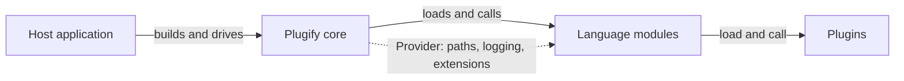

Здесь описан Plugify 3 (ядро 3.1): что делает ядро, как оно находит и загружает расширения и как плагины на разных языках вызывают друг друга.

## Из чего состоит



| Часть | Что делает |
|---|---|
| **Хост** | Приложение, которое встраивает ядро: хост игрового сервера вроде S2-Launcher, ваша программа или тестовое приложение `plug`. Он создаёт ядро, каждый кадр вызывает `Update` и завершает его работу |
| **Ядро** | Библиотека `plugify`. Находит манифесты, проверяет их, разрешает зависимости, загружает расширения по порядку и ведёт их жизненный цикл. С плагинами напрямую не общается |
| **Языковой модуль** | Нативная библиотека, реализующая `ILanguageModule`. Загружает плагины одного языка, запускает и останавливает их и делает методы всех плагинов доступными на своём языке |
| **Плагин** | Код на каком-либо языке с манифестом `*.pplugin`. Методы, перечисленные в манифесте, может вызвать любой другой плагин |

Языковые модули и плагины вместе называются **расширениями**: их описывает один класс `Extension`, и у них общие конвейер загрузки, состояния, зависимости и конфликты. C++-плагин ядро загружает через C++-модуль, как и любой другой плагин.

## API хоста

Хост работает с тремя объектами:

- `PlugifyBuilder` настраивает ядро: папки, конфиг, логгер и сервисы. Его создаёт `Plugify::CreateBuilder()`, а `Build()` возвращает ядро.
- `Plugify` — объект ядра: `Initialize()` проверяет и создаёт папки, `Update()` вызывается каждый кадр, `Terminate()` всё выгружает.
- `Manager`, его возвращает `GetManager()`, загружает расширения методом `Initialize()`, выгружает методом `Terminate()` и ищет их: `FindExtension`, `GetExtensions`, `GetExtensionsByState`, `IsExtensionLoaded`.

Методы, которые могут завершиться ошибкой, возвращают `plugify::Result<T>`, то есть `std::expected<T, std::string>`: ошибка — это текст. `Initialize`, `Update` и `Terminate` нужно вызывать из потока, который создал ядро.

:read-more{icon="lucide:plug" to="/ru/core/embedding/integrating" title="Интеграция"}

### Конфигурация

`Build()` собирает настройки из трёх источников, каждый следующий перекрывает предыдущий:

1. файл конфига, переданный через `WithConfigFile`;
2. `Config`, переданный через `WithConfig`;
3. `WithBaseDir` и `WithPaths`.

Само ядро файл конфига не ищет. Если `baseDir` пуст, берётся текущая папка. Остальные папки отсчитываются от `baseDir`. `Initialize()` завершается ошибкой, если `baseDir` не существует, а недостающие остальные папки создаёт.

### Сервисы

Свои составные части ядро берёт из локатора сервисов. Для тех, что вы не заменили, `Build()` регистрирует реализации по умолчанию:

| Сервис | Метод билдера | По умолчанию |
|---|---|---|
| `ILogger` | `WithLogger` | Пишет в консоль |
| `IFileSystem` | `WithFileSystem` | Обычная файловая система |
| `IAssemblyLoader` | `WithAssemblyLoader` | Загружает нативные библиотеки загрузчиком платформы |
| `IDependencyResolver` | `WithDependencyResolver` | libsolv |
| `IProfiler` | `WithProfiler` | Нет |
| `IExtensionLifecycle` | `WithExtensionLifecycle` | Нет. Если задан, получает уведомление о каждой загрузке, запуске, обновлении, остановке и выгрузке |

Языковые модули получают те же сервисы через `Provider::Resolve<T>()`.

## Расширения и манифесты

### Файлы манифестов

У каждого расширения есть манифест, файл JSON в корне его папки. Комментарии разрешены. Манифесты бывают трёх видов:

| Файл | Что описывает |
|---|---|
| `*.pplugin` | Плагин: его язык, точку входа, зависимости и экспортируемые методы |
| `*.pmodule` | Языковой модуль: язык, который он обслуживает, и его библиотеку |
| `*.pconfig` | Настройки ядра. Необязателен, читается, только когда загрузчик передаёт его ядру |

Необязательный ключ `$schema` включает автодополнение в редакторах. Ключи, которых нет в схеме, делают манифест невалидным.

#### Манифест плагина

```json [my_plugin.pplugin]
{
  "$schema": "https://raw.githubusercontent.com/untrustedmodders/plugify/refs/heads/main/schemas/plugin.schema.json",
  "name": "my_plugin",
  "version": "1.0.0",
  "description": "An example plugin",
  "author": "Your Name",
  "website": "https://example.com",
  "license": "MIT",
  "language": "cpp",
  "entry": "bin/my_plugin",
  "platforms": [],
  "dependencies": [
    { "name": "s2sdk", "constraints": ">=3.0.0" },
    { "name": "configs", "optional": true }
  ],
  "methods": [
    {
      "name": "AddNumbers",
      "funcName": "AddNumbers",
      "paramTypes": [
        { "name": "a", "type": "int32" },
        { "name": "b", "type": "int32" }
      ],
      "retType": { "type": "int32" }
    }
  ]
}
```

| Поле | Обязательное | Значение |
|---|---|---|
| `name` | да | Уникальное имя: буквы, цифры и `_`, начинается с буквы или `_`. Пишите в `snake_case`. На него ссылаются зависимости и импорт |
| `version` | да | Семантическая версия, `MAJOR.MINOR.PATCH` |
| `description`, `author`, `website`, `license` | да | Сведения о плагине. `website` это URL `http(s)` |
| `language` | да | Язык плагина. Должен совпадать с `language` установленного модуля: `cpp`, `dotnet`, `golang`, `python3`, `javascript`, `lua`, `rust` |
| `entry` | да | Точка входа. Её формат зависит от языка, см. страницу First Plugin вашего языка |
| `platforms` | нет | Платформы, которые поддерживает плагин. Пустой список означает все |
| `dependencies` | нет | Плагины, которые должны загрузиться раньше: `name`, необязательные `constraints` и `optional` |
| `conflicts` | нет | Плагины, вместе с которыми этот загружать нельзя: `name`, необязательные `constraints` и `reason` |
| `obsoletes` | нет | Плагины, которые этот заменяет, для переименований и слияний |
| `methods` | нет | Функции, которые плагин экспортирует другим плагинам |
| `classes` | нет | Классы-обёртки над функциями, работающими с хэндлами |
| `prototypes`, `enums` | нет | Общие сигнатуры колбэков и перечисления, на которые методы ссылаются по имени |

**Ограничения версий** это сравнения с полной версией: `>=1.0.0`, `<2.0.0`, `=1.2.3`. Части через пробел должны выполняться все, а `||` означает «или»: `>=1.0.0 <2.0.0 || >3.2.1`.

**Методы.** `name` это публичное имя, а `funcName` сообщает языковому модулю, где находится реализация. В `paramTypes` перечислено до 32 параметров, у каждого есть `type`. Параметр с `"ref": true` передаётся по ссылке, и вызванная функция может его изменить. Параметру типа `function` нужен `prototype`, который описывает колбэк, а целочисленный параметр может нести `enum`.

**Типы**: `void`, `bool`, `char8`, `char16`, `int8`, `int16`, `int32`, `int64`, `uint8`, `uint16`, `uint32`, `uint64`, `ptr64`, `float`, `double`, `function`, `string`, `any`, `vec2`, `vec3`, `vec4`, `mat4x4` и массивы, которые пишутся как `int32[]`, `string[]` и так далее.

#### Манифест языкового модуля

```json [python3_module.pmodule]
{
  "$schema": "https://raw.githubusercontent.com/untrustedmodders/plugify/refs/heads/main/schemas/module.schema.json",
  "name": "python3_module",
  "version": "1.0.0",
  "description": "Adds support for Python3 plugins",
  "author": "untrustedmodders",
  "website": "https://github.com/untrustedmodders/",
  "license": "MIT",
  "language": "python3",
  "platforms": [],
  "directories": ["python3.12"]
}
```

| Поле | Обязательное | Значение |
|---|---|---|
| `name`, `version`, `description`, `author`, `website`, `license` | да | Как у плагина |
| `language` | да | Язык, который обслуживает модуль. Плагины ссылаются на него своим `language` |
| `runtime` | нет | Путь к библиотеке модуля, без префикса `lib` и расширения. По умолчанию `bin/` и имя файла манифеста |
| `directories` | нет | Дополнительные папки для поиска библиотек |
| `platforms`, `dependencies`, `conflicts`, `obsoletes` | нет | Как у плагина |

#### Конфиг ядра

```json [plugify.pconfig]
{
  "$schema": "https://raw.githubusercontent.com/untrustedmodders/plugify/refs/heads/main/schemas/config.schema.json",
  "paths": {
    "baseDir": ".",
    "extensionsDir": "extensions",
    "configsDir": "configs",
    "dataDir": "data",
    "logsDir": "logs",
    "cacheDir": "cache"
  },
  "loading": {
    "preferOwnSymbols": false,
    "maxConcurrentLoads": 4
  },
  "logging": {
    "severity": "info"
  }
}
```

Все поля необязательны. `paths` задаёт папки относительно `baseDir`, `loading` управляет загрузкой расширений, в `security` лежат списки `whitelistedExtensions`, `blacklistedExtensions` и `excludedDirs`, а `logging.severity` принимает одно из значений `all`, `trace`, `debug`, `info`, `warning`, `error`, `fatal`. Загрузчик передаёт файл ядру через `WithConfigFile`, см. [Встраивание](/ru/core/embedding/integrating).
## Загрузка

`Manager::Initialize()` прогоняет конвейер из пяти стадий. Расширение, не прошедшее стадию, останавливается на ней с ошибкой, остальные идут дальше.


### Поиск

Ядро рекурсивно обходит `extensionsDir`. Файл `*.pplugin` — это плагин, файл `*.pmodule` — языковой модуль. Если в папке есть манифест, в её подпапки ядро не заходит. В одной папке может лежать несколько манифестов: так conda-окружение хранит все свои пакеты. Папки из `excludedDirs` пропускаются; по умолчанию это `disabled`, `.git`, `.svn`, `temp` и `tmp`.

### Разбор

Манифесты читаются параллельно, по `maxConcurrentLoads` одновременно. Каждый проверяется по своей JSON-схеме, а затем на согласованность: прототипы и перечисления, на которые ссылаются методы, должны существовать и не противоречить друг другу. Манифест, не прошедший проверку, получает состояние `Corrupted` с причиной.

### Разрешение зависимостей

На этой стадии ядро видит все расширения сразу:

- расширения, не разрешённые `whitelistedExtensions`, `blacklistedExtensions` или `platforms`, получают состояние `Disabled`;
- каждый плагин неявно зависит от модуля своего `language`;
- решатель [libsolv](https://github.com/openSUSE/libsolv) проверяет зависимости, ограничения версий, конфликты и `obsoletes`. Расширение, требования которого не выполнить, получает `Unresolved` с причиной: неудовлетворённая зависимость, конфликт, замена другим расширением или другая установленная копия с более новой версией;
- по зависимостям вычисляется порядок загрузки. Необязательная зависимость загрузку не блокирует, но если она установлена, загружается раньше.

### Загрузка, экспорт, запуск

Последние три стадии проходят по расширениям по одному, в порядке загрузки.

1. **Загрузка.** Для модуля ядро загружает его библиотеку и вызывает `GetLanguageModule()` и `Initialize`. Для плагина вызывает `OnPluginLoad` его модуля; модуль загружает плагин и возвращает адреса его методов.
2. **Экспорт.** Для каждого плагина с методами ядро вызывает `OnMethodExport` **у каждого** модуля, чтобы каждый язык сделал эти методы доступными своим плагинам.
3. **Запуск.** Ядро вызывает `OnPluginStart` каждого плагина.

Все плагины загружены и экспортированы до запуска первого из них, поэтому в `OnPluginStart` уже доступны все методы зависимостей плагина.

Если расширение не загрузилось, зависящие от него расширения получают `Skipped`, и так далее по цепочке. Сбой необязательной зависимости зависящие от неё расширения не пропускает. Если по окончании загрузки что-то не запустилось, ядро пишет в лог отчёт с причиной по каждому расширению.

`loadTimeout`, `exportTimeout` и `startTimeout` ничего не прерывают: расширение, которое уложилось не в срок, получает предупреждение в списке проблем.

### Состояния

Расширение проходит состояния `Discovered`, `Parsing`, `Parsed`, `Resolving`, `Resolved`, `Loading`, `Loaded`, `Exporting`, `Exported`, `Starting`, `Started`, `Running`, а при завершении `Ending`, `Ended`, `Terminating`, `Terminated`. Сбой заканчивается состоянием `Corrupted`, `Unresolved`, `Disabled`, `Failed` или `Skipped`.

### Обновление и завершение

`Plugify::Update()` вызывает `OnUpdate` у каждого работающего модуля и `OnPluginUpdate` у каждого работающего плагина, у которого он есть. Если время не передано, ядро измеряет его само.

`Manager::Terminate()` вызывает `OnPluginEnd` плагинов в обратном порядке загрузки, затем, тоже в обратном порядке, выгружает плагины и модули. Перезагрузки отдельного плагина нет: хост перезагружает всё, вызывая `Terminate()` и `Initialize()` менеджера. Некоторые среды выполнения нельзя выгрузить из процесса, например Go и .NET, поэтому их библиотеки остаются в памяти.

## Вызовы между языками

Плагин перечисляет свои методы в манифесте. При загрузке его языковой модуль отдаёт ядру нативный указатель на функцию для каждого метода. Для C++ и другого нативного кода это сама функция. Для остальных языков модуль во время выполнения генерирует небольшую нативную функцию, которая преобразует аргументы и вызывает код плагина.

Чтобы вызвать метод другого плагина, модуль берёт этот нативный указатель. Нативные языки вызывают его напрямую, остальные через сгенерированную модулем функцию, которая преобразует их значения в типы Plugify.

Генератор кода для обоих направлений, `JitCallback` и `JitCall`, есть в ядре; он построен на [asmjit](https://asmjit.com/) для x86-64 и ARM64. Строки, массивы и другие сложные значения передаются как типы `plg::` из ядра, которые одинаково устроены в памяти во всех модулях.

:read-more{icon="lucide:shuffle" to="/ru/core/language-modules/runtime-marshalling" title="Маршалинг во время выполнения"}

## Платформы

Ядро собирается на Windows, Linux и macOS для x86-64 и ARM64, а также содержит платформенный код для Android, BSD, PlayStation и Nintendo Switch. Строка платформы, с которой сравнивается поле `platforms` манифеста, задаётся при сборке ядра: `<система>_<архитектура>`, например `windows_x64` или `steamrt_x64`. На Linux системой считается идентификатор дистрибутива машины сборки, поэтому официальные билды для Counter-Strike 2, собранные в Steam Runtime, сообщают `steamrt_x64`.

На Windows ядро не загружает языковой модуль, собранный в другой конфигурации (debug или release), чем само ядро.
